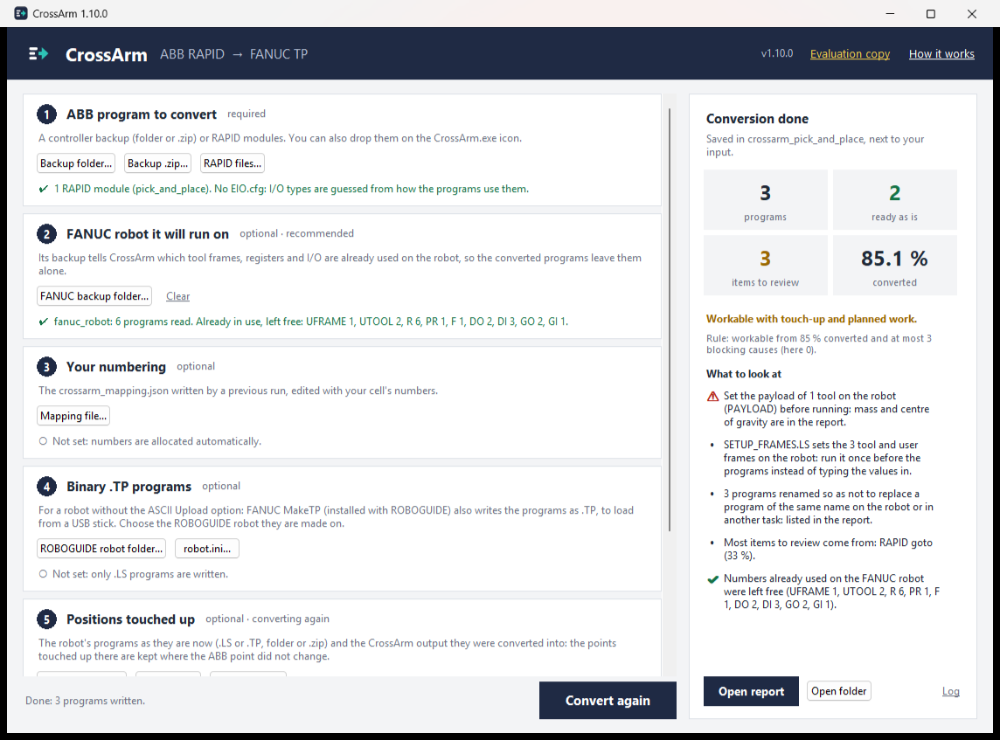

# CrossArm — ABB RAPID to FANUC TP converter

[](https://github.com/LeroyDu56/CrossArm/actions/workflows/tests.yml)
[](https://github.com/LeroyDu56/CrossArm/releases/latest)
[](LICENSING.md)

**CrossArm converts ABB robot programs (RAPID) into FANUC TP programs (`.LS`), and lists what is left
to do before commissioning.** It is for integrators and plant teams moving a cell from ABB to FANUC
robots, who would otherwise rewrite every program by hand.

**[Download CrossArm.exe](https://github.com/LeroyDu56/CrossArm/releases/latest)** — Windows, nothing
to install, runs offline (or Python 3.11+ on any system, no dependencies).

- **In:** a RobotWare 6 / 7 backup (folder or `.zip`) or RAPID modules; optionally the backup of the FANUC
  robot in place, whose numbers and program names are left alone.
- **Out:** one TP program per routine, `SETUP_FRAMES.LS` for the frames, an HTML report that opens on a
  decision (ready, workable, not ready) with a commissioning checklist, and an editable numbering file.
- **Not 100 %, not plug-and-play.** About 60 % of the instructions convert on public programs, 87 % to 93 %
  on our own test corpus; the rest is marked `!TODO` with its cause, never guessed. The output is a
  starting point for **commissioning**: check it in ROBOGUIDE, touch up the points on the robot.
- **Licence:** free for evaluation and other non-production use; production use (programs run on a real
  robot, delivered to a customer, billed migration work) needs a commercial licence:
  **enzoleroy56@gmail.com** ([LICENSING.md](LICENSING.md)).

[User guide](docs/guide.md) · [How it was validated](docs/validation.md) · [FAQ](#faq) ·
[Changelog](CHANGELOG.md)

## Try it in 2 minutes

1. Download **`CrossArm.exe`** from the [latest release](https://github.com/LeroyDu56/CrossArm/releases/latest)
   and open it.
2. Choose the **ABB program**: a backup folder, a `.zip` or RAPID files (a sample:
   [pick_and_place.mod](tests/fixtures/rapid/pick_and_place.mod)). Optionally, the backup of the **FANUC
   robot** it will run on.
3. **Convert.** The window gives the decision, how many programs are ready as is and what to look at first.
   The programs and `crossarm_report.html` land in a new `crossarm_<name>` folder next to the input.



From the command line (`crossarm`, or `CrossArm.exe` with the same commands):

```
crossarm convert abb_backup/ --fanuc fanuc_backup/
```

The other steps of the window and every option: [user guide](docs/guide.md#the-window).

## An example

RAPID in, from [tests/fixtures/rapid/pick_and_place.mod](tests/fixtures/rapid/pick_and_place.mod):

```
PROC Pick()
    ! approach, grip, retract
    MoveJ Offs(pPick,0,0,100),v1000,z20,tGripper;
    MoveL pPick,v200,fine,tGripper;
    Set DO_GripperClose;
    WaitTime 0.3;
    MoveL Offs(pPick,0,0,100),v500,z10,tGripper;
ENDPROC
```

FANUC TP out, from [tests/fixtures/fanuc/pick_and_place/PICK.LS](tests/fixtures/fanuc/pick_and_place/PICK.LS):

```
/MN
   1:  !RAPID PickAndPlace.Pick ;
   2:  ! approach, grip, retract ;
   3:  UFRAME_NUM=0 ;
   4:  UTOOL_NUM=2 ;
   5:J P[1] 22% CNT55    ;
   6:L P[2] 200mm/sec FINE    ;
   7:  DO[1]=ON ;
   8:  WAIT    .30(sec) ;
   9:L P[1] 500mm/sec CNT54    ;
/POS
P[1]{
   GP1:
	UF : 0, UT : 2,		CONFIG : 'N U T, 0, 0, 1',
	X =   812.350  mm,	Y =  -245.100  mm,	Z =   405.000  mm,
	W =  -179.293 deg,	P =     0.000 deg,	R =   -90.000 deg
};
...
```

And the [report](tests/fixtures/fanuc/pick_and_place/crossarm_report.md) that goes with it.

## What to expect

- **Motion, I/O, logic and data convert**: moves with their targets, configuration, speeds and zones, tool and
  user frames, payloads, signals typed by `EIO.cfg`, `IF` / `TEST` / `FOR` / `WHILE`, calls with arguments,
  records, strings, interrupts, the backup's own FUNCs and errors ([full table](docs/guide.md#what-is-converted)).
- **About 60 % of the instructions on public open-source programs** (from about 15 % to all of them per
  project), **87 % to 93 % on our own test corpus**, written for testing. Converted means written in TP and
  loaded by the controller without an error, not validated on a robot ([why not 100 %](#why-not-100-)).
- **The points are the ABB's, to be touched up.** The path stays within 10 mm of the ABB's (measured: within
  4 mm); the FANUC robot is not where the ABB was, so every point is re-taught at commissioning.
- **Measured, not assumed:** every form of instruction CrossArm writes was read back from a FANUC controller
  in ROBOGUIDE, and its 40 controller probes on ROBOGUIDE and RobotStudio were all run again for 1.10.0
  ([validation](docs/validation.md)).
- **Check on your robot model:** reachability and posture in ROBOGUIDE; speeds and zones are measured for the
  M-20iD, R-2000iC and R-1000iA series ([speeds and zones](docs/guide.md#speeds-and-zones)).

## Beyond the basics

Each in the [user guide](docs/guide.md):
[your own numbering](docs/guide.md#numbering-mapping-file-and-target-robot) (`crossarm_mapping.json`) ·
[converting again without losing the touch-ups](docs/guide.md#converting-again-keeping-the-touch-ups)
(`--keep-taught`) · [programs you provide](docs/guide.md#programs-you-provide) for routines TP cannot write ·
[KAREL programs](docs/guide.md#karel-programs---karel) for what TP cannot compute (`--karel`) ·
[frames calibrated at run time](docs/guide.md#frames-and-points-the-programs-compute) ·
[binary `.TP`](docs/guide.md#binary-tp-programs) through FANUC MakeTP ·
[the report](docs/guide.md#reading-the-report) · [the tool on the flange](docs/guide.md#the-tool-on-the-flange) ·
[roadmap](docs/guide.md#roadmap).

## Help improve CrossArm

CrossArm improves on the backups people actually have. Two commands help, and both leave everything on your
computer until you decide to send it:

- **`crossarm diagnose BACKUP`** (**Create diagnostic report** in the window) writes `crossarm_diag.md` and
  `crossarm_diag.json`: what CrossArm understood and converted, as counts only, with no name, comment, text,
  number or path of the backup. The window shows the `.md` and opens the
  [issue form](https://github.com/LeroyDu56/CrossArm/issues/new?template=diagnostic_report.yml) in your browser,
  where you attach the two files.
- **`crossarm anonymize BACKUP`** writes a `.zip` of the backup that converts the same, every name and text
  replaced, the comments removed, the positions moved; e-mail it to **enzoleroy56@gmail.com** if you would
  rather not publish it.

Nothing is sent automatically: CrossArm has no network code. What the files contain:
[docs/diagnostic.md](docs/diagnostic.md).

**The first 10 users who send a diagnostic report (or an anonymized backup) made from a real backup get a free one-year commercial licence, at the author's discretion: one per company, sent by e-mail.**

## FAQ

### How do I convert an ABB RAPID program to FANUC TP?
Open [CrossArm.exe](https://github.com/LeroyDu56/CrossArm/releases/latest), choose the ABB backup (folder or
`.zip`) or the RAPID modules, optionally the backup of the FANUC robot, and click **Convert**. From the
command line: `crossarm convert abb_backup/ --fanuc fanuc_backup/`.

### Are the converted programs ready to run on the robot?
No, and every report says so. They are a starting point for commissioning: set the payloads, check frames
and reachability, work through every `!TODO`, touch up the points. ROBOGUIDE is the place to do that first.

### Why not 100 %?
Some RAPID has no TP equivalent without KAREL or a robot option (files, sockets, operator dialogs), some is
not converted yet (handlers of system errors, some run-time values and conditions), and some programs are not
complete (routines or data from another project). The report gives each `!TODO` its cause
([details](docs/guide.md#why-not-100-)).

### Is CrossArm free?
Free for evaluation and other non-production use (development, testing, teaching, personal
projects); production use needs a commercial licence: enzoleroy56@gmail.com ([LICENSING.md](LICENSING.md)).

### Does my backup leave my computer?
No. CrossArm runs entirely offline and writes its output next to your input.

### What does the diagnostic report contain?
Counts only: the CrossArm version and operating system, the RobotWare version and options, how many tasks,
modules, routines and lines, how often each RAPID instruction and function is used and how many of those uses
were converted, the causes of TODO, the share converted per task, signal counts by type and CrossArm's own
errors. Never a name, comment, text, number or path of the backup; a test checks it. Read `crossarm_diag.md`
before sending it: it is the whole report ([docs/diagnostic.md](docs/diagnostic.md)).

More questions (robtargets and `CONFIG`, numbering, supported versions, other brands):
[user guide FAQ](docs/guide.md#faq).

## Documentation

- [User guide](docs/guide.md): [quick start](docs/guide.md#quick-start),
  [upgrading to 1.10](docs/guide.md#upgrading-to-110), then the reference: inputs and outputs, the full conversion table, the report, numbering and the
  mapping file, programs you provide, converting again, KAREL, calibration, the tool on the flange, speeds
  and zones, FAQ and roadmap.
- [How it was validated](docs/validation.md): a [one-page summary](docs/validation.md#summary), then every
  probe and measurement.
- [FANUC `.LS` format status](docs/fanuc_ls_format.md) and [design notes](docs/design.md).
- [Contributing](CONTRIBUTING.md) · [Changelog](CHANGELOG.md), with what 1.x keeps stable · to cite
  CrossArm, **Cite this repository** on GitHub ([CITATION.cff](CITATION.cff)).

## License

CrossArm is published under the [Business Source License 1.1](LICENSE).

- **Non-production use is free**: reading the code, building it, evaluating it on your own backups,
  development, testing, teaching and personal projects. Nothing is locked: the programs then start with
  `CrossArm EVALUATION copy`.
- **Production use requires a commercial licence**: converting programs that run on a real robot, that are
  delivered to a customer, or that are part of billed migration work. Its licence file replaces the mark with
  the licence number and company name. Where the line falls: [LICENSING.md](LICENSING.md); getting one:
  [LICENSE-COMMERCIAL.md](LICENSE-COMMERCIAL.md); contact: **enzoleroy56@gmail.com**.
- Each released version becomes Apache 2.0 four years after it is published (v1.10.1 on 2030-10-12; every
  date in [LICENSING.md](LICENSING.md)). Versions published before 1.0.0 keep the licence they were published
  under. Third-party components bundled in `CrossArm.exe`: [THIRD_PARTY_LICENSES.md](THIRD_PARTY_LICENSES.md).

FANUC, ROBOGUIDE and KAREL are trademarks of FANUC Corporation. ABB, RAPID, RobotStudio and RobotWare are
trademarks of ABB Ltd. **CrossArm is an independent project, not affiliated with or endorsed by either
company.** The `.LS` and RAPID formats were worked out by observing files and controller round trips, for
interoperability.
